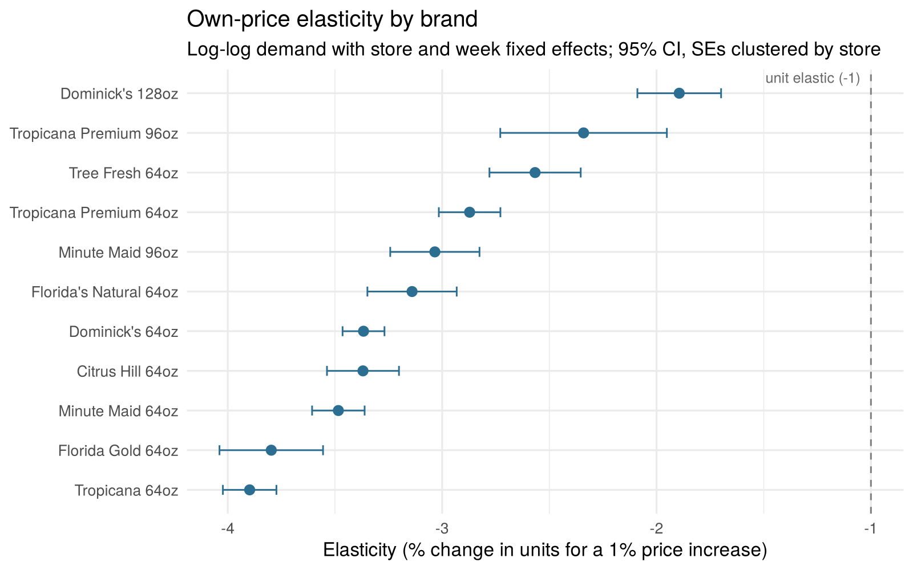
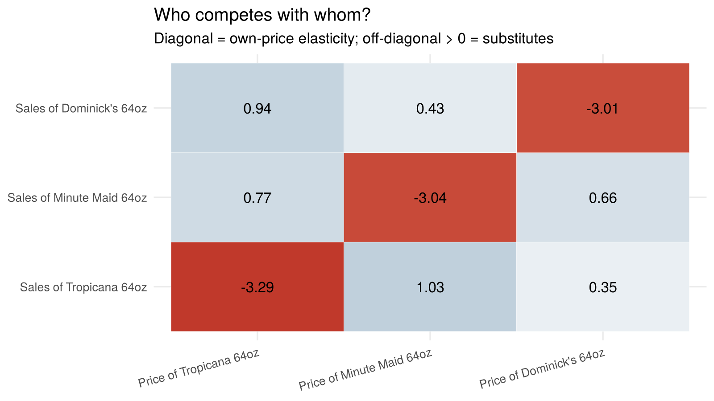
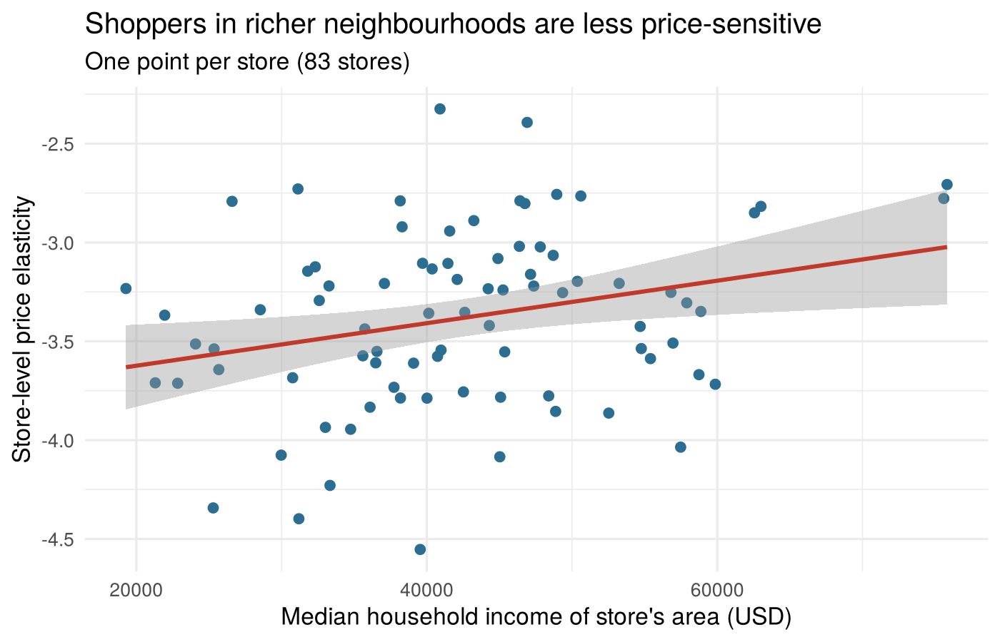
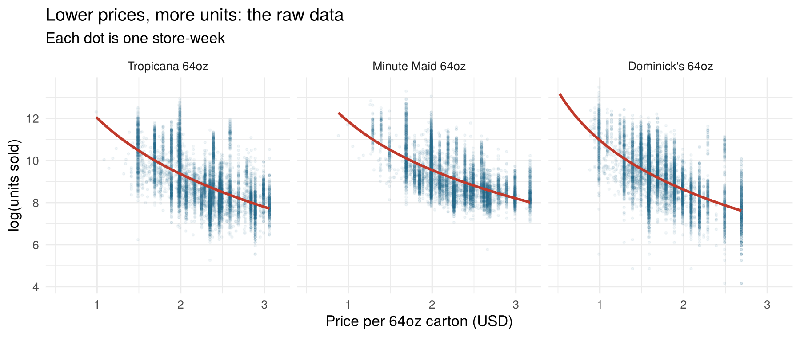

# How Price-Sensitive Are Orange Juice Shoppers?

**Estimating own- and cross-price elasticities of demand with supermarket scanner data**

Linfei (Sophie) Shan · B.A. Economics, UC Santa Barbara · R

---

## Question

When a grocery chain cuts the price of a brand of orange juice, how much more does it sell? Whose sales does it take? Which brands and neighbourhoods are most price-sensitive? What markup does economic theory say each brand can sustain?

## Data

Dominick's Finer Foods (a Chicago supermarket chain), refrigerated orange juice:

- **106,139** store-brand-week observations: **83 stores**, **11 brands**, weeks 40–160 (about 2.3 years)
- Units sold, the price of every brand in the store that week, feature-advertising and in-store deal indicators
- Store-level census demographics (income, education, age)

Source: Montgomery (1997), *Marketing Science* 16(4), distributed in the R package [`bayesm`](https://cran.r-project.org/package=bayesm) as `orangeJuice`. The original file is in `data/orangeJuice.rda`.

## Method

Log-log demand, where the price coefficient **is** the elasticity:

```
log(Q_bst) = β_b · log(P_bst) + γ·Feature + δ·Deal + α_b + μ_s + τ_t + ε
```

- `α_b`, `μ_s`, `τ_t`: brand, store and week fixed effects. They absorb brand quality, store size and seasonality.
- Standard errors are clustered by store.
- Extensions:
    - brand-specific elasticities
    - price × feature-advertising interaction
    - price × store-income interaction
    - a cross-price elasticity matrix for the three largest 64oz brands
    - an **instrumental-variables** check using a Hausman instrument: the same brand's average price in all other stores that week

## Key results

| Finding | Estimate |
|---|---|
| Average own-price elasticity (store & week FE) | **−3.21** (SE 0.05) |
| Same, instrumented (Hausman IV; first-stage F ≈ 5,700) | **−3.58** (SE 0.06) |
| Naive estimate with no controls | −1.51. Biased toward zero because premium brands are both pricier and popular. |
| Most / least elastic brand | Tropicana 64oz **−3.90** / Dominick's 128oz **−1.89** |
| Elasticity when not featured vs. fully featured in the ad circular | −2.97 vs. **−3.87** |
| Effect of a 1 SD higher neighbourhood income on elasticity | **+0.44**: less price-sensitive |
| Tropicana price cut → Dominick's store-brand sales (cross-elasticity) | **+0.94**. Dominick's price cut → Tropicana: only +0.35. |

**Three takeaways**

1. **Demand is very elastic in the short run.** A 10% price cut raises units by about 32%. These are mostly promotional responses, such as brand switching and stocking up, so they overstate long-run sensitivity.
2. **Competition is asymmetric.** National brands steal more from the store brand than the store brand steals from them. This is the classic pattern of price-tier competition.
3. **Targeting pays.** Shoppers in higher-income areas are measurably less price-sensitive. That supports store-level ("micro-marketing") pricing rather than one chain-wide price.

The **inverse-elasticity (Lerner) rule**, (P − MC)/P = −1/ε, implies profit-maximising markups of 26% for Tropicana 64oz up to 53% for Dominick's 128oz. The full table is in `output/tables/brand_elasticities.csv`.

## Figures

| | |
|---|---|
|  |  |
|  |  |

## Limitations

- **Short-run elasticities.** Weekly data capture promotion responses, including stockpiling. Long-run elasticities would be smaller.
- **Endogeneity.** Fixed effects and the Hausman instrument help, but the instrument assumes no chain-wide demand shocks beyond what week fixed effects absorb.
- **Lerner markups are a benchmark.** A retailer maximises category profit across brands, so cross-price effects lower the optimal markup on any single brand.

## Reproduce

```bash
# R 4.x with: install.packages(c("sandwich", "lmtest", "AER", "ggplot2"))
Rscript code/01_elasticity_analysis.R      # ~3 minutes
```

Outputs: `output/regression_results.txt`, `output/tables/*.csv`, `output/figures/*.png`. A two-page summary is in `memo.md`; the full write-up is in `report.pdf`.
